# Лабораторная работа №3. Облачные сети.
( Ответы на контрольные вопросы были представлены в отчете по м ере выполнения заданий)

## Цели работы
Научиться вручную создавать виртуальную сеть (VPC) в AWS, добавлять в неё подсети, таблицы маршрутов, интернет-шлюз (IGW) и NAT Gateway, а также настраивать взаимодействие между веб-сервером в публичной подсети и сервером базы данных в приватной.

### Создание VPC
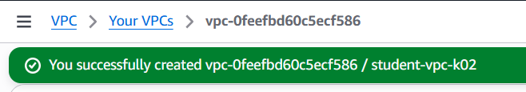
Я создала собственную виртуальную сеть (VPC), которая служит изолированной средой внутри AWS. В ней размещаются все подсети, таблицы маршрутов, интернет-шлюзы и серверы. При создании я задала имя student-vpc-k02, а также указала диапазон адресов 10.2.0.0/16

- **Что обозначает маска /16? И почему нельзя использовать, например, /8?**
Маска /16 означает, что первые 16 бит адреса это часть сети, а оставшиеся 16- для хостов.
Такой диапазон достаточно большой и совместим с требованиями AWS. Маску /8 использовать нельзя, потому что она создаёт слишком большую сеть (16 миллионов адресов), что неэффективно и не разрешено в AWS.

### Создание Internet Gateway (IGW)
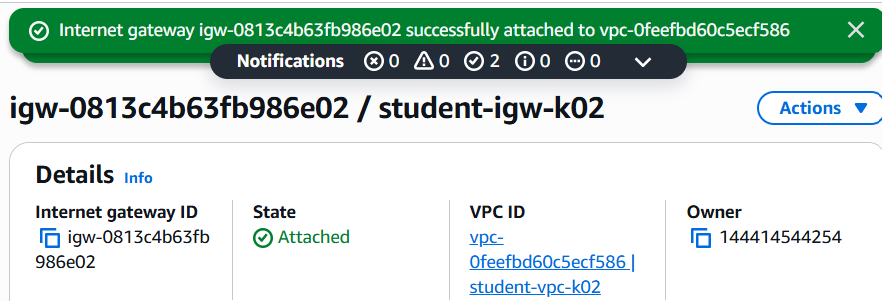
На этом этапе я создала Internet Gateway (IGW) - это компонент, который обеспечивает соединение моей виртуальной сети с Интернетом. Без него даже публичные инстансы с назначенными IP не смогут выходить во внешнюю сеть. Я задала имя student-igw-k02 и прикрепила его к своей VPC. После этого IGW стал “точкой выхода” в Интернет для ресурсов, находящихся в публичных подсетях.

### Создание подсетей
Создание публичной подсети и приватной подсети
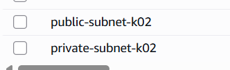
1) Для этого выбрала свою VPC, задала имя public-subnet-k02, зону доступности eu-central-1a и адресный диапазон 10.2.1.0/24.

- **Является ли подсеть "публичной" на данный момент? Почему?**
На этом этапе публичная подсеть ещё не является публичной, потому что в её таблице маршрутов нет выхода в Интернет (через IGW).

2) Затем я создала вторую подсеть с именем private-subnet-k02, выбрав другую зону доступности и диапазон 10.2.2.0/24. Она предназначена для размещения внутренних ресурсов, например, сервера базы данных.

- **Является ли подсеть "приватной" на данный момент? Почему?**
Да, потому что у неё нет маршрутов, ведущих во внешние сети, и она полностью изолирована внутри VPC.

### Создание таблиц маршрутов (Route Tables)
1) Создание публичной таблицы маршрутов
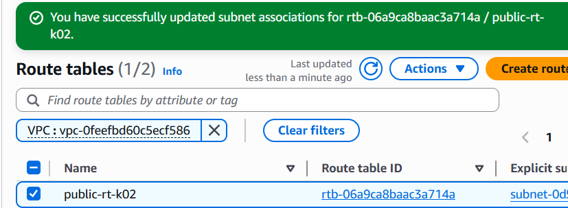
(public-rt-k02): я добавила маршрут 0.0.0.0/0, направленный на Internet Gateway (student-igw-k02). Это позволяет ресурсам в публичной подсети обращаться к Интернету. Таблицу я привязала к public-subnet-k02.

- **Зачем необходимо привязать таблицу маршрутов к подсети?**
Привязка таблицы маршрутов к подсети необходима, чтобы подсеть начала использовать нужные маршруты. Без привязки она использует таблицу по умолчанию и не сможет выходить в Интернет.

2) Создание приватной таблицы маршрутов
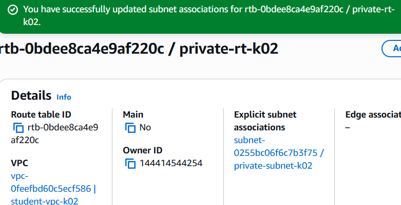
(private-rt-k02): я создала отдельную таблицу для приватной подсети и привязала её к private-subnet-k02. Пока в ней отсутствовал маршрут наружу, поэтому инстансы внутри оставались полностью изолированными.

### Создание NAT Gateway
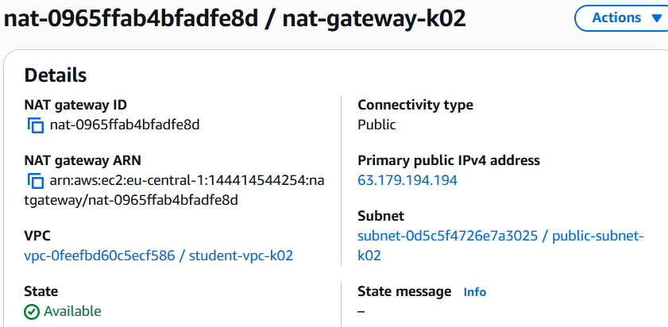
Сначала я зарезервировала Elastic IP- статический публичный адрес, который закрепляется за аккаунтом. Затем создала NAT Gateway с именем nat-gateway-k02 в публичной подсети (public-subnet-k02), выбрала выделенный Elastic IP и дождалась, пока его статус стал Available.
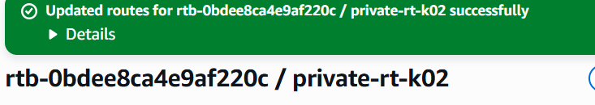
После этого я открыла приватную таблицу маршрутов (private-rt-k02) и добавила маршрут 0.0.0.0/0 с направлением на NAT Gateway.

- **Как работает NAT Gateway?**
NAT Gateway позволяет инстансам в приватной подсети обращаться к Интернету (например, для обновлений), но внешние пользователи не могут инициировать соединение с ними напрямую.
Он заменяет их приватные IP на один общий публичный IP.

### Создание Security Groups
Я создала три группы безопасности:
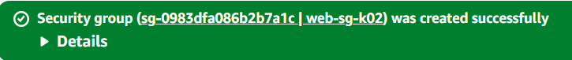
для веб-сервера, с разрешением HTTP/HTTPS из Интернета
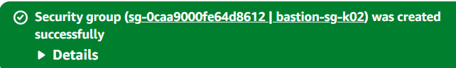
для Bastion Host, с разрешением SSH только с моего IP
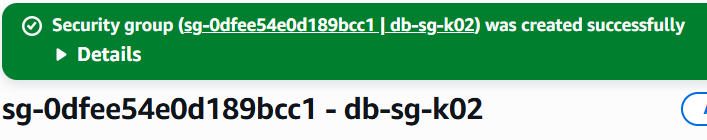
для базы данных, с доступом по MySQL только от веб-сервера и SSH только от Bastion Host

- **Что такое Bastion Host и зачем он нужен в архитектуре с приватными подсетями?**
Bastion Host- это специальный сервер в публичной подсети, через который осуществляется безопасное подключение к ресурсам в приватной сети (например, к базе данных).
Он нужен, чтобы не открывать прямой доступ в Интернет к приватным серверам.

### Создание EC2-инстансов
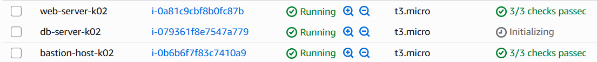

### Проверка работы
Я убедилась, что все инстансы успешно запущены.
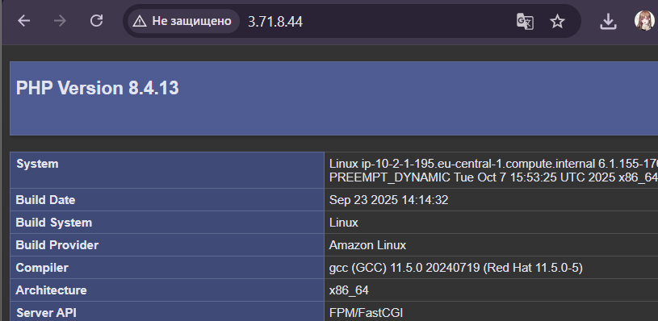
и откройте его в браузере. Вы должны увидеть страницу с информацией о PHP.
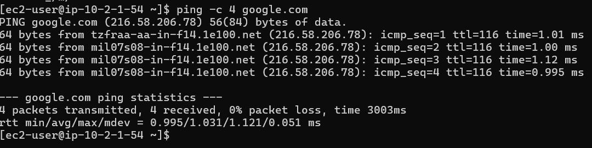
Затем я подключилась по SSH к Bastion и проверила доступ к Интернету и к базе данных в приватной подсети соединение прошло успешно, значит конфигурация сети корректна.
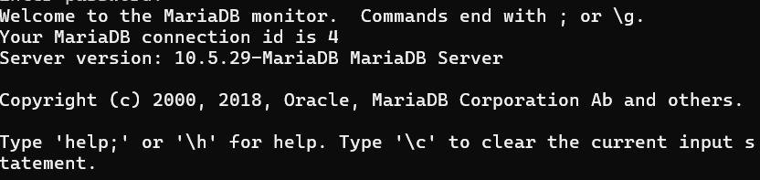
