# Лабораторная работа №6. Балансирование нагрузки в облаке и авто-масштабирование
(ответы на контрольные вопросы представлены в ходе выполнения)

## Цель работы
Закрепить навыки работы с AWS EC2, Elastic Load Balancer, Auto Scaling и CloudWatch, создав отказоустойчивую и автоматически масштабируемую архитектуру.


## Шаг 1. Создание VPC и подсетей

Мы создали VPC с CIDR `10.0.0.0/16`, затем:

* 2 публичные подсети — `10.0.1.0/24`, `10.0.2.0/24`
* 2 приватные подсети — `10.0.11.0/24`, `10.0.12.0/24`

Добавили:

* **Internet Gateway** — для выхода из публичных подсетей в интернет.
* **Маршрут в public Route Table**
  `0.0.0.0/0 → Internet Gateway`

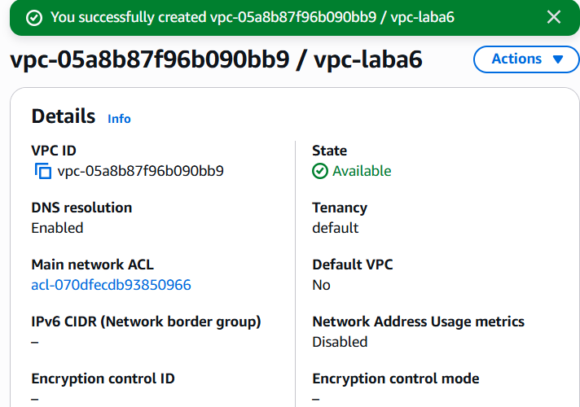

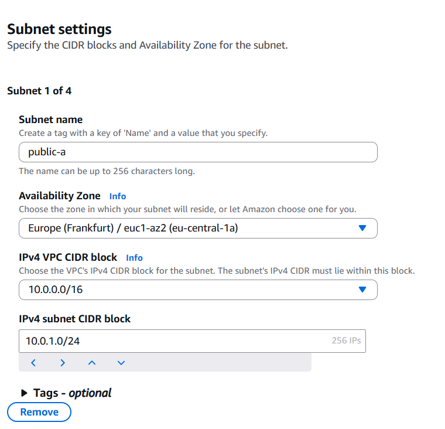

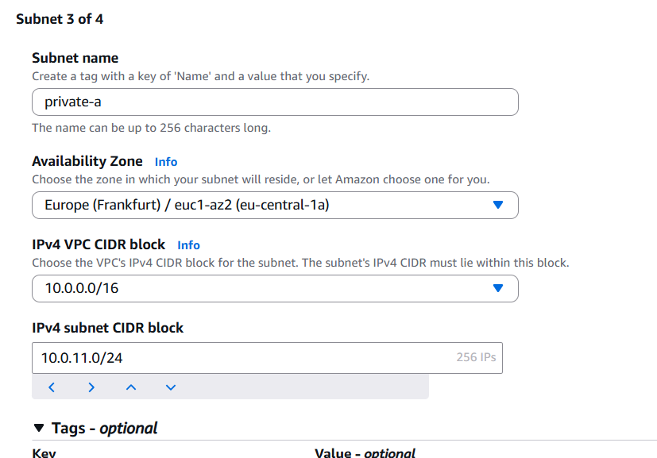

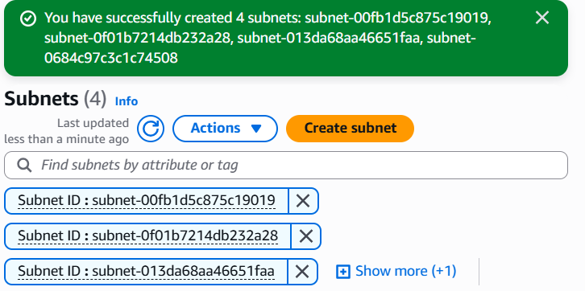

---

## Шаг 2. Создание виртуальной машины

Создан инстанс EC2:

* AMI: **Amazon Linux 2**
* Instance type: **t3.micro**
* Subnet: **публичная**
* Public IP: **включён**
* SG: разрешены

  * SSH (22) от собственного IP
  * HTTP (80) от всех

В разделе **User Data** установлен Nginx.

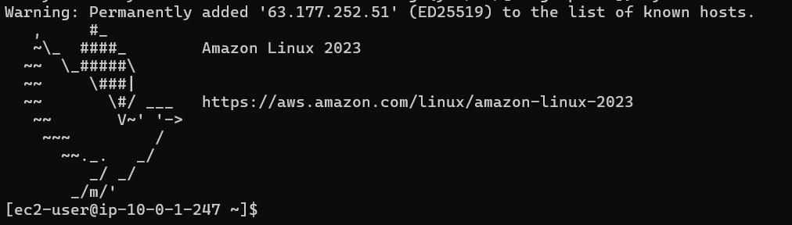

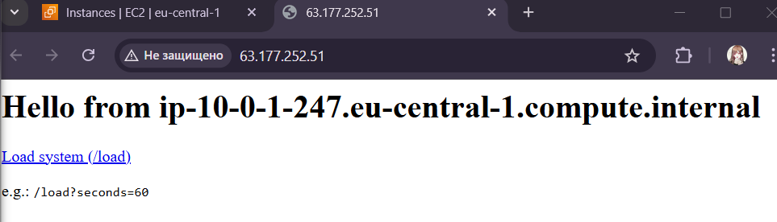

---

## Шаг 3. Создание AMI

AMI — это **образ виртуальной машины**, включающий:

* ОС
* программы
* настройки
* файлы

📌 **Чем AMI отличается от Snapshot?**

| AMI                                     | Snapshot                   |
| --------------------------------------- | -------------------------- |
| Готовый образ для запуска EC2           | Копия EBS диска            |
| Включает snapshot + метаданные instance | Только данные диска        |
| Можно запускать инстансы                | Используется как часть AMI |

**Варианты использования AMI:**

* запуск одинаковых серверов в Auto Scaling Group
* резервное копирование
* миграция между аккаунтами/регионами

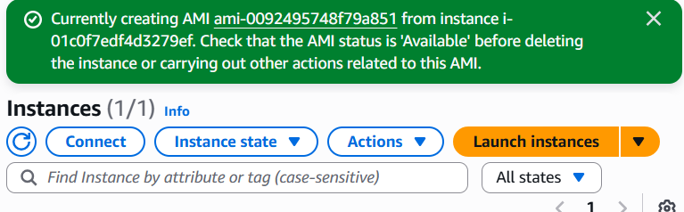

---

## Шаг 4. Создание Launch Template

**Launch Template — это шаблон конфигурации EC2**, который ASG будет использовать для запуска новых инстансов.

Содержит:

* выбранную AMI
* тип инстанса
* security group
* user-data
* роли
* настройки сети

📌 **Чем он отличается от Launch Configuration?**

| Launch Template              | Launch Configuration |
| ---------------------------- | -------------------- |
| Новый, рекомендуется         | Старый, устаревший   |
| Поддерживает версии          | Не поддерживает      |
| Поддерживает Mixed Instances | Нет                  |
| Более гибкий                 | Ограниченный         |

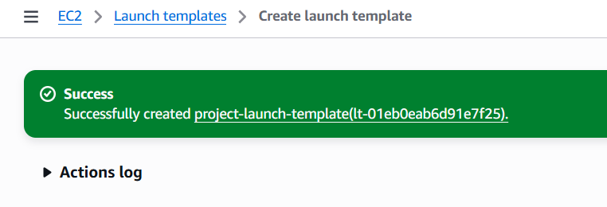

---

## Шаг 5. Создание Target Group

**Target Group** — это группа серверов, на которую ALB отправляет трафик.

Выполняет:

* проверку работоспособности (health checks)
* балансировку трафика
* маршрутизацию от ALB

Это “список” инстансов, которые получат трафик.

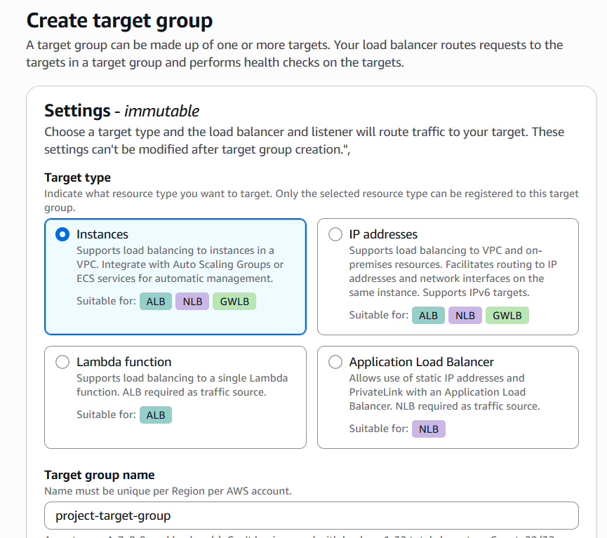

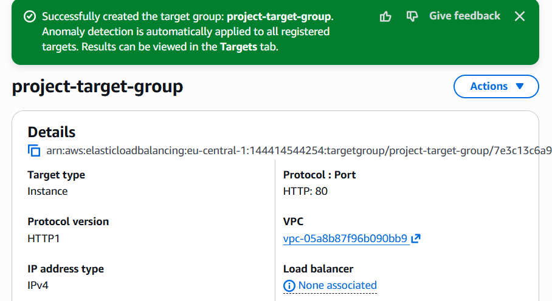

---

## Шаг 6. Создание Application Load Balancer

ALB распределяет входящий HTTP/HTTPS трафик.

Выбрано:

* Scheme → **Internet-facing**
  Значит ALB доступен из интернета.

📌 **Разница Internet-facing vs Internal**

| Internet-facing    | Internal                      |
| ------------------ | ----------------------------- |
| Имеет публичный IP | Только приватный IP           |
| Доступен извне     | Только внутри VPC             |
| Для веб-сайтов     | Для микросервисов внутри сети |

📌 **Что такое Default action?**

Это действие, которое ALB выполняет, если **правила маршрутизации не совпали**.

Типы:

* Forward (передать в target group)
* Redirect (например, на HTTPS)
* Fixed-response (вернуть код/текст)

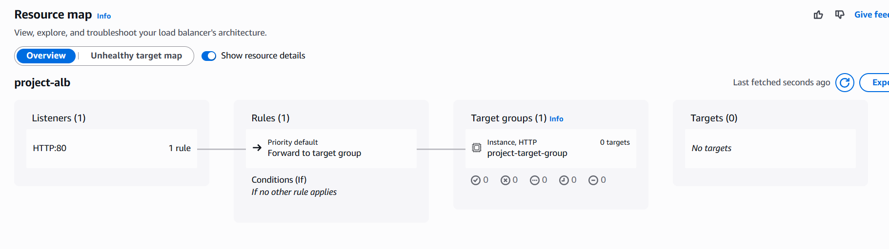

---

## Шаг 7. Создание Auto Scaling Group

ASG запускает, завершает и масштабирует EC2 автоматически.

**Почему выбираются приватные подсети?**

* инстансы не должны быть доступны прямо из интернета
* безопасность лучше
* трафик проходит через ALB

**Зачем нужна Availability Zone distribution?**

Она распределяет инстансы **по зонам доступности**, чтобы обеспечить:

* отказоустойчивость
* баланс нагрузки
* защиту от сбоя AZ

**Что такое Instance warm-up?**

Время, которое даётся новому инстансу:

* на запуск
* установку программ
* прогрев
* получение нормальных метрик

ASG **не будет использовать его CPU для scaling** до истечения warm-up.

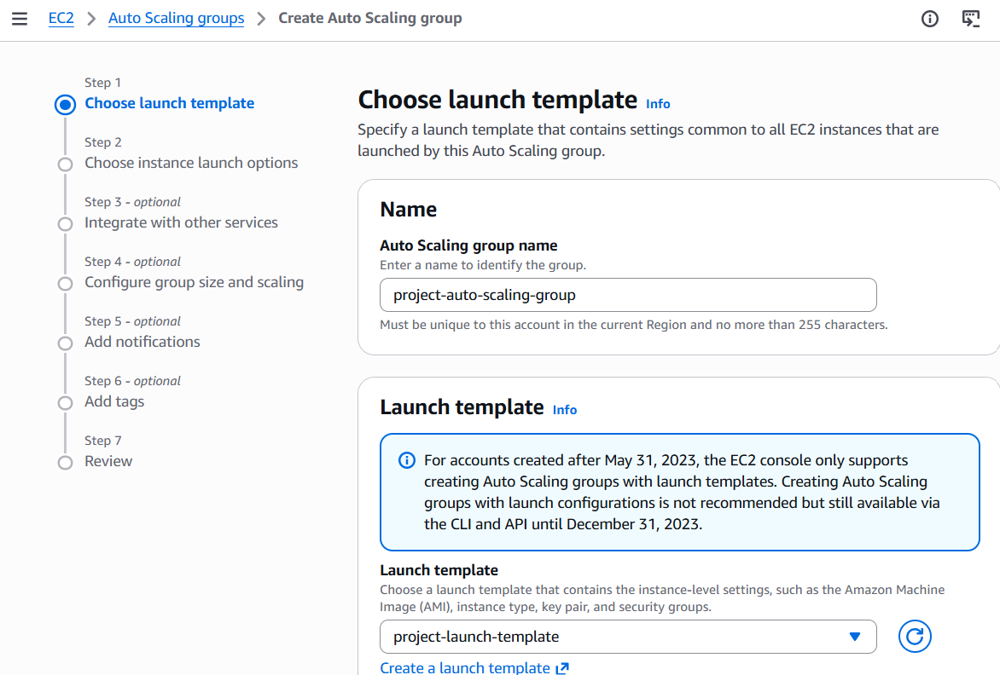

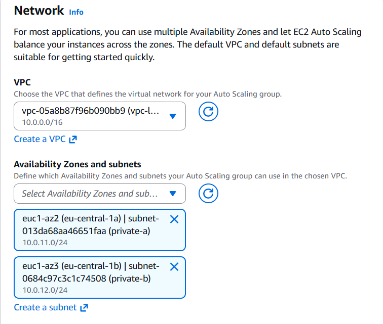
В методичке подсети указаны как публичные, но это упрощённый вариант, который используют для проверки работы напрямую с инстансом.
Когда я делала архитектуру, я выбрала приватные подсети, потому что так это работает в реальных проектах. Также приватные инстансы не получают публичных IP, и так легче контролировать доступ и безопасность. Поэтому, даже если в задании указаны публичные подсети, более правильный и современный вариант- использовать приватные. Именно его я и реализовала.

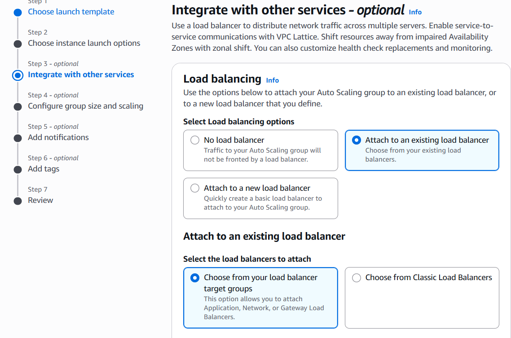

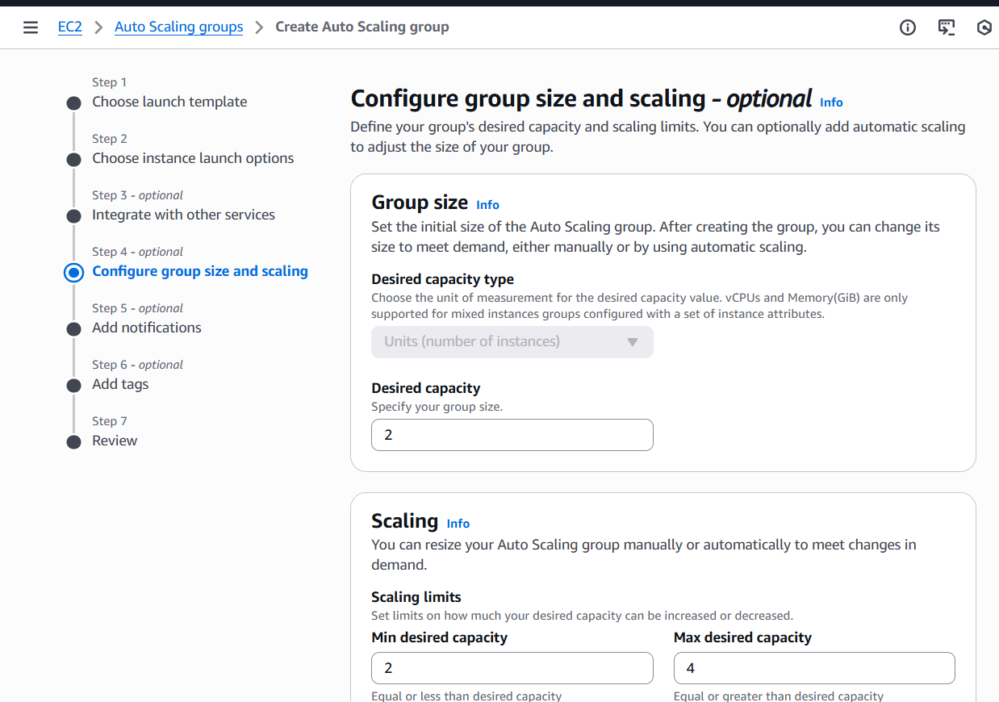

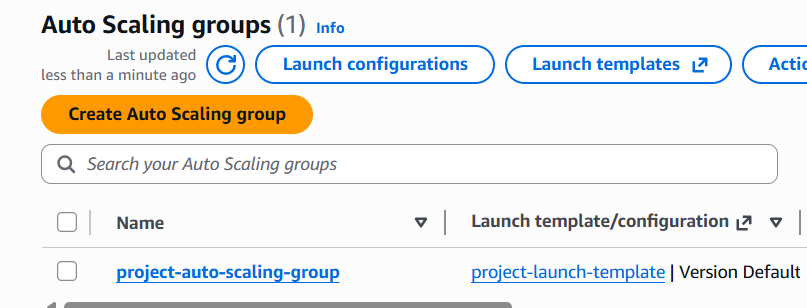

---

## Шаг 8. Тестирование Load Balancer

Мы открыли DNS ALB в браузере.
При обновлении страницы появляются **2 IP-адреса** — это IP двух Healthy EC2-инстансов.

📌 Почему только 2?

Потому что:

* желаемое количество инстансов (desired capacity) = **2**
* ASG создала 2 инстанса
* ALB распределяет запросы только между теми, что **Healthy**

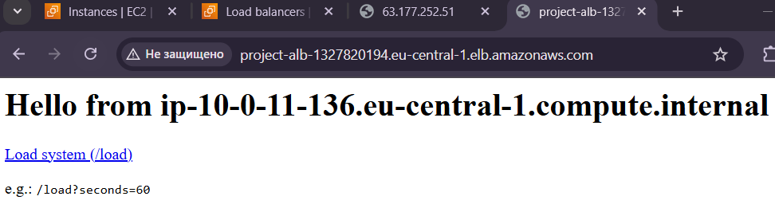

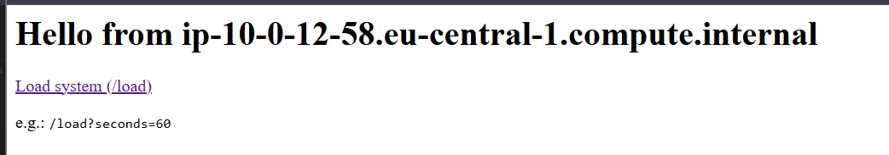

---

## Шаг 9. Тестирование Auto Scaling

Так как Target Tracking policy настроена на:

* **Average CPU = 50%**
* Warm-up = **60 сек**

Когда мы открыли:

```
http://<ALB-DNS>/load?seconds=60
```

6–7 вкладок → создают высокую нагрузку.

Auto Scaling выполняет:

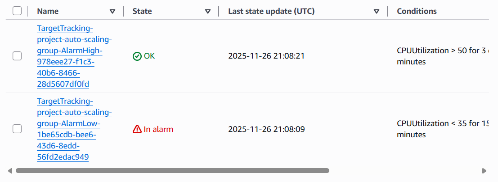

---

# 🎯 Какая роль Auto Scaling в этом процессе?

Auto Scaling:

* **автоматически следит за нагрузкой на серверы**
* **видит**, что CPU > 50%
* запускает **новые EC2 инстансы**
* распределяет их по зонам доступности
* автоматически прикрепляет их к Target Group
* после снижения нагрузки — **автоматически уменьшает** количество инстансов

### ❗ Ошибка №1: 504 Gateway Timeout от Load Balancer

ALB возвращал 504, потому что:

1) Причина
Инстансы ASG находились в приватных подсетях без выхода в интернет — NAT Gateway отсутствовал.
Из-за этого UserData не мог:
установить nginx
скачать пакеты
сервер не запускался → Health Check = Unhealthy

2) Решение
Добавили:
NAT Gateway
маршрут 0.0.0.0/0 → NAT Gateway в приватных подсетях
пересоздали инстансы через ASG Instance Refresh
После этого все таргеты стали Healthy.


### ❗ Ошибка №2: Target Group показывает Healthy = 0
1) Причины:
Скорее всего, Nginx не установился (из-за отсутствия NAT).
Или health check port/URI был неверным.

2) Решение:
Добавлен NAT Gateway
Проверен порт: 80
Проверен путь: /
Пересозданы инстансы
Health → 2/2 Healthy